# Simulation d'un réseau 4G LTE sous Cisco Packet Tracer

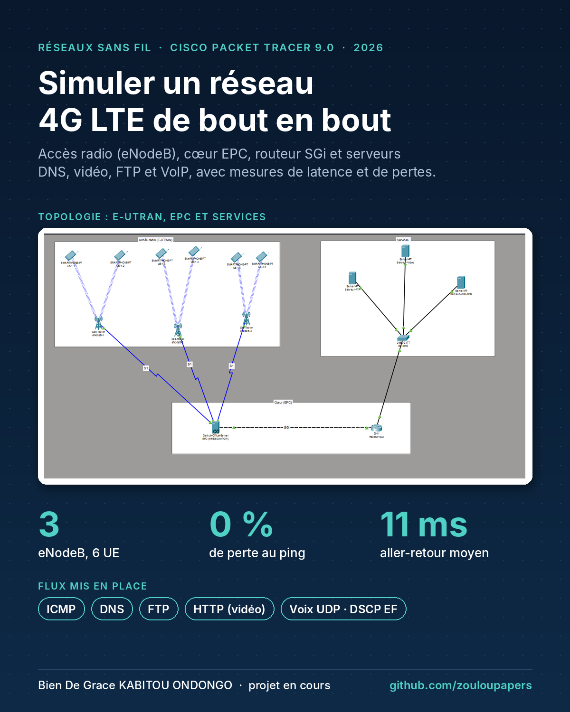

> **EN**: Wireless networks project (in progress). A 4G LTE network simulated in Cisco Packet Tracer 9.0: E-UTRAN radio access (3 eNodeB, 6 UEs), an EPC core, an SGi router and DNS, video (HTTP), FTP and VoIP servers. Voice, video, FTP, DNS and ICMP traffic are injected, with first latency and packet-loss measurements.

Projet individuel du module Technologies des réseaux sans fil (L3 Ingénierie des réseaux et systèmes, Université Centrale, Tunis), 2026-2027.

**État : en cours.** Ce dépôt présente le livrable 2 (version intermédiaire). La version finale et la démonstration suivront.

| Étape | Contenu | État |
|---|---|---|
| Livrable 1 | Conception | Rendu |
| Livrable 2 | Version intermédiaire : topologie, configurations, premiers flux et mesures | En cours (ce dépôt) |
| Livrable 3 | Version finale : débits, handover, optimisation | À venir |
| Soutenance | Démonstration en direct | Fin de semestre |

## Objectifs du livrable 2

- Mettre en place la topologie 4G LTE dans Packet Tracer 9.0.
- Configurer les eNodeB, l'EPC, le routeur SGi et les serveurs.
- Injecter les flux voix (VoLTE simulée), vidéo HTTP, FTP, DNS et ICMP.
- Relever les premières mesures de latence, de pertes et de service.

## Topologie

Trois zones reliées par les interfaces S1 et SGi :
- **accès radio E-UTRAN** : 3 eNodeB et 6 smartphones (UE), 2 par cellule ;
- **cœur EPC** : MME, SGW et PGW regroupés dans le *Central Office Server* de Packet Tracer ;
- **services** : un switch et trois serveurs (FTP, vidéo, VoIP/DNS) derrière un routeur Cisco 2911.

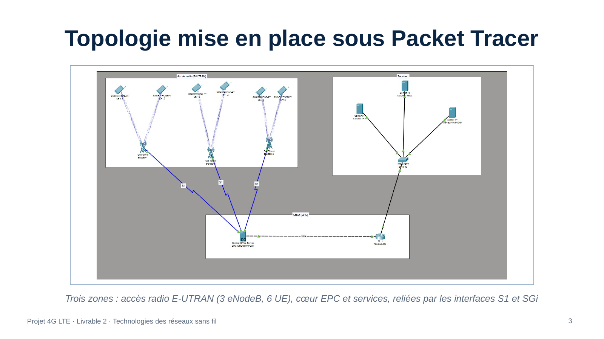

## Plan d'adressage IP et noms DNS

| Réseau ou équipement | Adresse | Nom DNS | Détail |
|---|---|---|---|
| Réseau des UE | 172.16.1.0/24 | — | Passerelle 172.16.1.1 (EPC), adresses attribuées par DHCP |
| Lien SGi | 192.168.5.0/30 | — | EPC 192.168.5.2, routeur 192.168.5.1 (G0/0) |
| Réseau des serveurs | 192.168.10.0/24 | — | Passerelle 192.168.10.1 (G0/1 du routeur) |
| Serveur FTP | 192.168.10.10 | ftp.lte.local | Téléchargement de fichiers |
| Serveur vidéo | 192.168.10.11 | video.lte.local | Streaming vidéo (HTTP) |
| Serveur VoIP/DNS | 192.168.10.12 | voip.lte.local | Voix et résolution de noms |

Route statique sur le routeur SGi : `172.16.1.0/24` via `192.168.5.2`, pour joindre les téléphones derrière l'EPC.

## Configuration

| EPC | Routeur SGi |
|---|---|
| 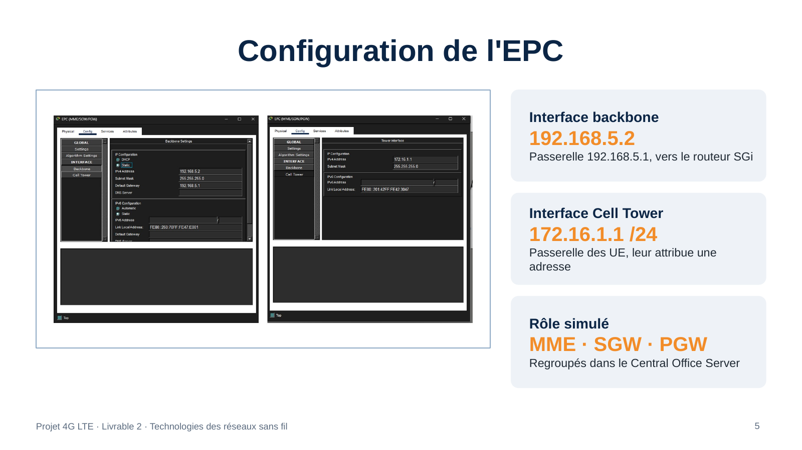 | 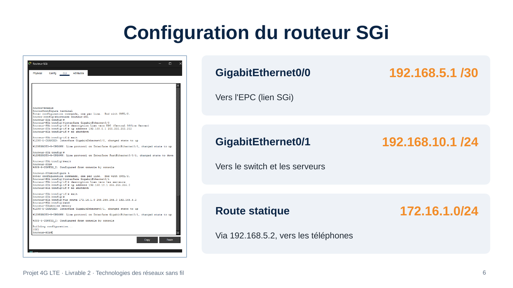 |

| Rattachement des UE aux eNodeB | Adressage des UE par DHCP |
|---|---|
| 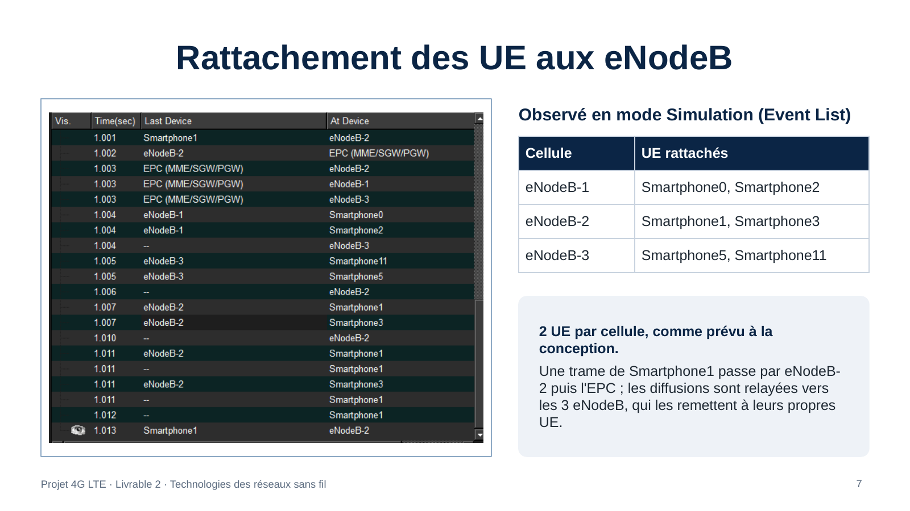 | 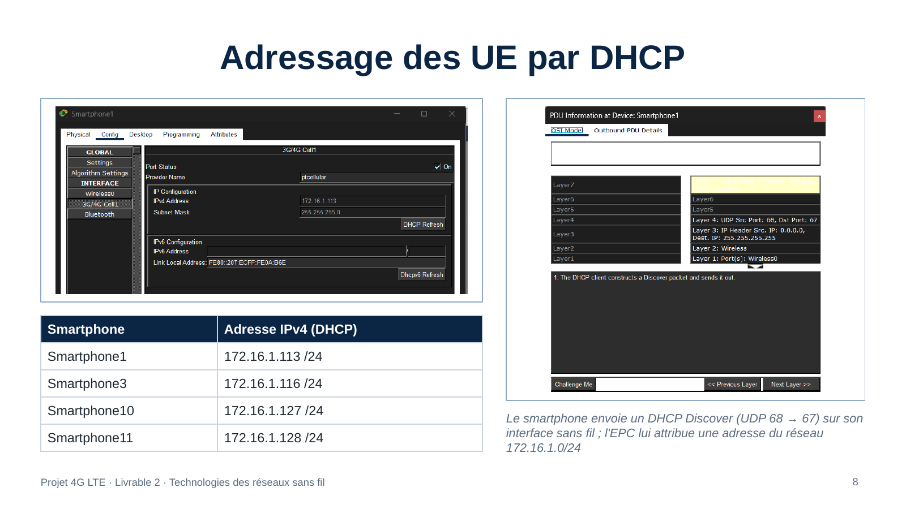 |

Services configurés :
- **DNS** : 3 enregistrements A dans la zone `lte.local` ;
- **HTTP** : page `video.html` sur le serveur vidéo ;
- **FTP** : deux comptes utilisateurs avec tous les droits.

## Plan d'injection du trafic

| Flux | Protocole | Source → destination | Outil Packet Tracer |
|---|---|---|---|
| Voix (VoLTE simulée) | UDP 16384, TOS 184 | UE → 192.168.10.12 | Complex PDU (mode Simulation) |
| Vidéo HD | HTTP (TCP 80) | UE → video.lte.local | Web Browser |
| Téléchargement | FTP (TCP 21) | UE → ftp.lte.local | Command Prompt : `ftp` |
| Résolution de noms | DNS (UDP 53) | UE → 192.168.10.12 | Command Prompt : `nslookup` |
| Latence et pertes | ICMP | UE → serveurs | Command Prompt : `ping -t` |

Les mesures chiffrées sont faites en mode *Realtime*, et le parcours des paquets est observé en mode *Simulation*.

| Flux DNS et FTP depuis un UE | Flux voix : VoLTE simulée |
|---|---|
| 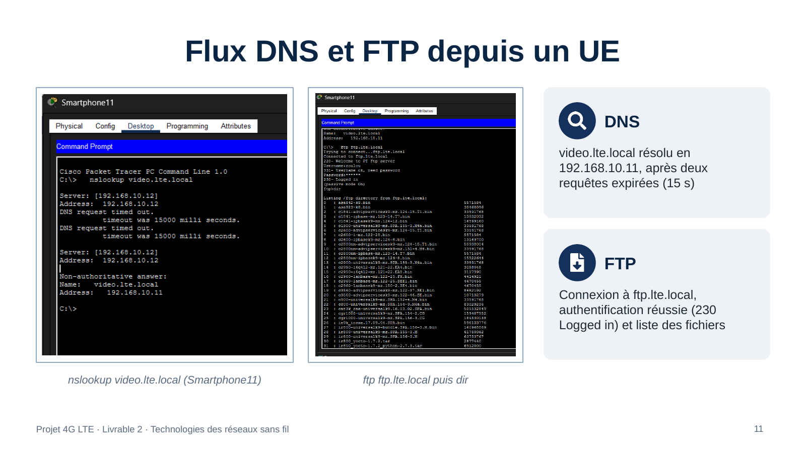 | 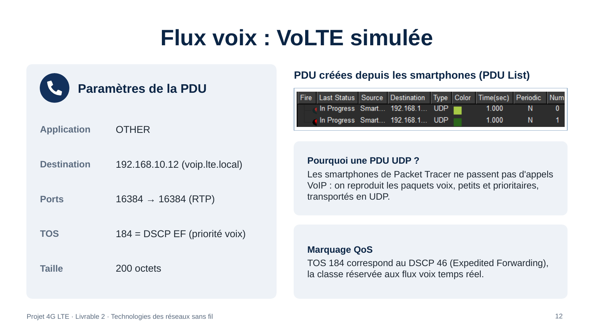 |

Les smartphones de Packet Tracer ne passent pas d'appels VoIP : les paquets voix sont reproduits par des PDU UDP de 200 octets, marquées TOS 184 (DSCP 46, *Expedited Forwarding*), la classe réservée à la voix temps réel.

## Premiers relevés

`ping -t 192.168.10.12` depuis un UE : **58 paquets envoyés, 0 % de perte, 11 ms aller-retour en moyenne** (5 à 24 ms). Le TTL de 126 montre que deux sauts sont traversés : l'EPC et le routeur SGi.

| Flux | Test réalisé | Résultat | Statut |
|---|---|---|---|
| ICMP | `ping -t` UE → 192.168.10.12 | 0 % de perte, 11 ms en moyenne (5 à 24 ms) | Validé |
| DNS | `nslookup video.lte.local` | Résolu en 192.168.10.11 après 2 requêtes expirées | Validé |
| FTP | Connexion puis `dir` | Authentification réussie, fichiers listés | Débit à mesurer |
| HTTP | Page `video.html` | Page publiée sur le serveur vidéo | Chargement à mesurer |
| Voix | 2 PDU UDP, TOS 184 | PDU émises depuis les smartphones | En cours |

La connectivité de bout en bout est validée (UE → eNodeB → EPC → routeur → serveurs). Il reste à chiffrer le débit et le temps de chargement.

| Latence et pertes | Synthèse |
|---|---|
| 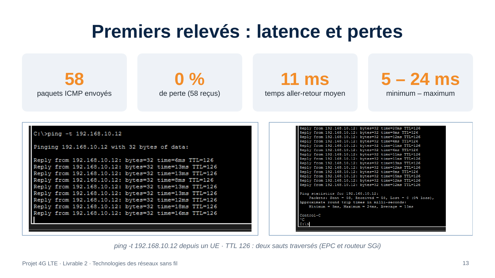 | 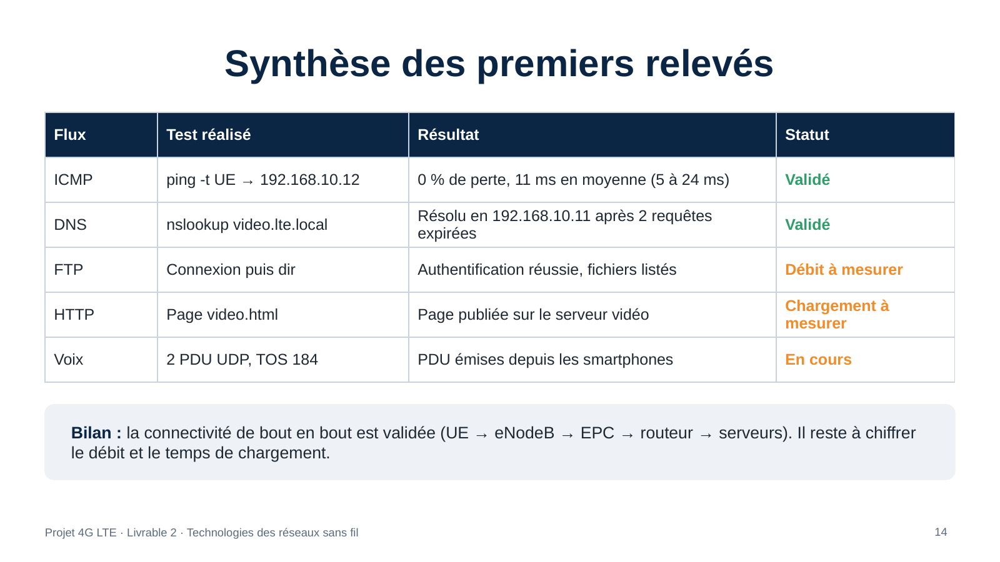 |

## Difficultés et limites

- **Ports refusés** (« Invalid Source Port ») : des espaces s'étaient glissés avant 16384. Corrigé en ressaisissant les valeurs.
- **Premières requêtes DNS expirées** : deux délais de 15 s avant la réponse, probablement le temps de résoudre le chemin (ARP). Les requêtes suivantes aboutissent.
- **Pas de vraie VoLTE** : la voix est reproduite par des PDU UDP marquées EF.
- **Pas de mesures radio** : Packet Tracer ne donne ni RSRP ni RSRQ, et ne permet pas de régler les bandes ni les blocs de ressources. Ces paramètres restent théoriques.

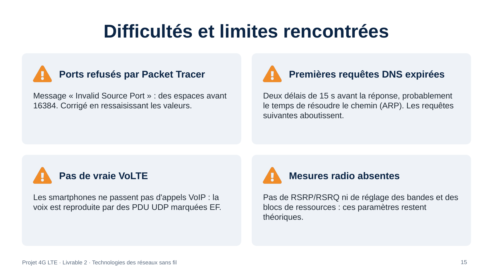

## Prochaines étapes (livrable 3)

1. Mesurer le débit FTP (`get`) et le temps de chargement HTTP.
2. Tester le handover en déplaçant un UE d'une cellule à l'autre.
3. Analyser la latence selon la distance entre l'UE et l'eNodeB.
4. Optimiser : ajout d'une cellule, priorité de la voix.
5. Rédiger le rapport final et préparer la démonstration en direct.

## Compétences mobilisées

4G LTE (E-UTRAN, eNodeB, EPC : MME, SGW, PGW) · interfaces S1 et SGi · adressage IPv4 et routage statique · DHCP · DNS · HTTP · FTP · QoS (DSCP EF) · mesures de latence et de pertes · Cisco Packet Tracer 9.0

## Auteur

**KABITOU ONDONGO Bien De Grace**, étudiant en L3 Ingénierie des réseaux et systèmes. Voir [github.com/zouloupapers](https://github.com/zouloupapers) et [linkedin.com/in/gracekabitou](https://www.linkedin.com/in/gracekabitou).
